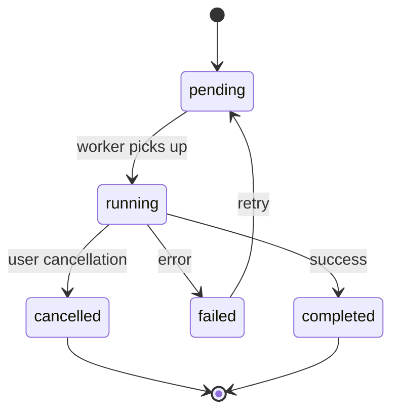

# Technical Specification: Job Service

## SPEC-ID: JOB-SPEC-001
## Version: 1.0
## Status: **HISTORICAL** (archived 2024-01-15)

> **Note**: This document is a historical draft from the project's early design phase. The current release-readiness plan is in `.plan/task.md` (updated November 2026). See the `.plan` directory for the active plan, release criteria, and M0-M5 milestones.

## Document: DRAFT
## Owner: @neuralforge/job
## Related: PROV-SPEC-001, TOOL-SPEC-001

---

## A. Identity

- **Spec ID**: JOB-SPEC-001
- **Name**: Job Service
- **Version**: 1.0
- **Status**: DRAFT
- **Owner**: @neuralforge/job
- **Related Requirements**: FR-001, FR-002, FR-003, FR-004, FR-005, FR-006, FR-007, FR-008
- **Dependencies**: @neuralforge/database, @neuralforge/browser, @neuralforge/policy, @neuralforge/runtime

---

## B. Purpose

The Job Service provides a robust queuing and execution system for AI agent tasks. It enables long-running asynchronous operations with:
- Task submission and tracking
- Status management (pending, running, completed, failed, cancelled)
- Retry mechanisms
- Persistence across restarts
- Event streaming for real-time updates
- Logging and audit trails

---

## C. Scope

**Included**:
- Job creation, queuing, and lifecycle management
- Status tracking and persistence
- Cancellation and retry functionality
- Log capture (stdout, stderr, transcript)
- Server-Sent Events (SSE) for real-time updates
- Database synchronization
- Timeout and TTL configuration

**Excluded**:
- Browser automation (handled by @neuralforge/browser)
- Tool execution (handled by @neuralforge/tools)
- Policy enforcement (handled by @neuralforge/policy)
- Provider authentication (handled by API layer)

---

## D. Functional Behavior

### Job Lifecycle



### State Transitions

| From | To | Trigger | Condition |
|------|----|---------|-----------|
| pending | running | worker.assign | slot available |
| running | completed | task.success | no errors |
| running | failed | task.error | execution error |
| running | cancelled | user.request | cancellation accepted |
| failed | pending | retry.request | retry enabled |
| * | * | timeout.exceeded | TTL exceeded |

### Core Workflows

1. **Create Job** → Validates task → Enqueues → Returns jobId
2. **Worker Loop** → Polls queue → Executes job → Updates status
3. **Cancel Job** → Marks cancelled → Interrupts execution
4. **Retry Job** → Resets status → Re-enqueues

### Validation Rules

- `task` must be non-empty string (min 1 char)
- `provider` must be valid active provider
- `projectRoot` must be absolute path
- `allowedTools` must be subset of configured tools
- `metadata` must be serializable JSON

---

## E. Technical Design

### Architecture

```
┌──────────────────────────────────────────────────────┐
│                    Job Service API                   │
├──────────────────────────────────────────────────────┤
│   HTTP Endpoints    │    Internal Logic              │
│   /v1/jobs          │    ┌─────────────────┐         │
│   /v1/jobs/:id      │    │  Job Queue      │         │
│   /v1/jobs/:id/status│    │  Worker Pool    │         │
│   /v1/jobs/:id/cancel│    │  Status Store   │         │
│   /v1/jobs/:id/retry │    │  Logger         │         │
│   /v1/jobs/:id/logs │    │  DB Sync        │         │
│   /v1/jobs/:id/events│    └─────────────────┘         │
└──────────────────────────────────────────────────────┘
```

### Module Structure

- `src/index.ts` — Main entry point
- `src/job-store.ts` — In-memory + DB synchronization
- `src/worker.ts` — Job execution worker pool
- `src/job-validator.ts` — Input validation
- `src/logger.ts` — Log capture and persistence
- `src/event-broadcaster.ts` — SSE event streaming

### Concurrency Model

- **Job Queue**: Single-threaded FIFO (priority-based future)
- **Worker Pool**: Configurable concurrent workers (default: 1)
- **Database**: PGlite with WAL for ACID transactions
- **SSE**: One connection per client, heartbeat every 30s

### Database Schema

```sql
CREATE TABLE jobs (
  job_id TEXT PRIMARY KEY,
  task TEXT NOT NULL,
  status TEXT NOT NULL,
  provider TEXT NOT NULL,
  project_root TEXT,
  payload JSONB,
  created_at TIMESTAMP NOT NULL,
  updated_at TIMESTAMP NOT NULL,
  completed_at TIMESTAMP,
  result JSONB,
  error JSONB
);

CREATE INDEX idx_jobs_status ON jobs(status);
CREATE INDEX idx_jobs_created_at ON jobs(created_at);
```

---

## F. Data Contract

### JobRecord Interface

```typescript
interface JobRecord {
  jobId: string;              // UUID v4
  task: string;               // User task description
  status: JobStatus;          // Enum
  provider: string;           // Provider ID (chatgpt, gemini, etc)
  projectRoot: string;        // Absolute path
  allowedTools: string[];     // Tool allowlist
  metadata: Record<string, unknown>;
  createdAt: string;          // ISO 8601
  updatedAt: string;          // ISO 8601
  completedAt?: string;       // ISO 8601
  result?: { message: string };
  error?: { message: string; code?: string };
}

type JobStatus = 
  | "pending"
  | "running"
  | "completed"
  | "failed"
  | "cancelled";
```

### API Response Models

**Job Creation (POST /v1/jobs)**

```json
{
  "jobId": "f47ac10b-58cc-4372-a567-0e02b2c3d479",
  "task": "Create hello world",
  "status": "pending",
  "provider": "chatgpt",
  "projectRoot": "/home/user/project",
  "metadata": {}
}
```

**Job Status (GET /v1/jobs/:id/status)**

```json
{
  "jobId": "f47ac10b-58cc-4372-a567-0e02b2c3d479",
  "status": "running",
  "provider": "chatgpt",
  "updatedAt": "2024-01-15T10:30:00Z"
}
```

### Event Stream (SSE)

```text
event: status
data: {"jobId":"...","status":"running"}

event: logs
data: {"jobId":"...","stdout":"...","stderr":"..."}
```

---

## G. API Contract

### Endpoint: POST /v1/jobs

**Request Body**
```json
{
  "task": "Create a React component",
  "provider": "chatgpt",
  "projectRoot": "/home/user/project",
  "allowedTools": ["fs.read", "fs.write", "terminal.exec"],
  "metadata": { "context": "feature-work" }
}
```

**Response**: 201 Created
```json
{
  "jobId": "uuid",
  "task": "Create a React component",
  "status": "pending",
  "provider": "chatgpt",
  "projectRoot": "/home/user/project",
  "metadata": { "context": "feature-work" },
  "createdAt": "2024-01-15T10:30:00Z",
  "updatedAt": "2024-01-15T10:30:00Z"
}
```

### Endpoint: GET /v1/jobs/:id

**Response**: 200 OK
```json
{
  "jobId": "uuid",
  "task": "Create a React component",
  "status": "completed",
  "provider": "chatgpt",
  "projectRoot": "/home/user/project",
  "result": { "message": "Component created successfully" },
  "createdAt": "2024-01-15T10:30:00Z",
  "completedAt": "2024-01-15T10:35:00Z"
}
```

### Error Responses

```json
{
  "error": {
    "code": "VALIDATION_ERROR",
    "message": "Task must be non-empty string",
    "status": 400
  }
}
```

```json
{
  "error": {
    "code": "NOT_FOUND",
    "message": "Job not found",
    "status": 404
  }
}
```

```json
{
  "error": {
    "code": "PROVIDER_NOT_CONNECTED",
    "message": "Provider 'chatgpt' must be connected before a job can run.",
    "status": 409
  }
}
```

---

## H. Security

### Trust Boundaries

- **API Layer**: Public access (no auth in current scope)
- **Job Execution**: Sandboxed via policy engine
- **File System**: Restricted to workspace boundaries
- **Terminal**: Restricted to allowed commands (configurable)

### Data Protection

- No credentials stored in job records
- Payloads serialized as JSON (no binary data)
- Logs truncated at 100KB per stream
- Database writes use parameterized queries

### Approval Integration

Job execution calls policy engine before:
- File operations (`fs.read`, `fs.write`, `fs.edit`)
- Terminal commands (`terminal.exec`)
- Browser automation (already authenticated)

---

## I. Reliability

### Failure Handling

| Failure Type | Recovery Strategy |
|--------------|-------------------|
| Database crash | WAL recovery on restart |
| Worker crash | Job re-queued on next start |
| Provider disconnect | Job marked failed |
| Timeout | Job marked failed |
| Cancellation | Graceful shutdown |

### Timeouts

- **Job TTL**: Configurable (default: 30 minutes)
- **Worker Heartbeat**: 10 seconds
- **SSE Client Timeout**: 60 seconds
- **Database Query**: 30 seconds

### Retry Logic

- **Max Retries**: 3
- **Backoff**: Exponential (1s, 2s, 4s)
- **Dead Letter**: After max retries → failed state

---

## J. Performance

### Expected Workload

| Metric | Value |
|--------|-------|
| Concurrent Jobs | 100+ (configurable workers) |
| Job Creation Rate | 100/sec |
| Status Polling | 1000 clients |
| SSE Connections | 500 concurrent |
| Log Size | 100KB per stream max |

### Performance Sensitive Paths

1. **Job Creation** → Validate → Enqueue → Return (target: <100ms)
2. **Status Query** → Index lookup (target: <50ms)
3. **SSE Broadcast** → Memory push (target: <10ms)
4. **Log Write** → Async append (target: <10ms)

### Resource Constraints

- **Memory**: 50MB per worker max
- **Disk**: 1GB for logs/jobs (rotating)
- **CPU**: Worker pool size × 2 cores

### Caching Strategy

- Job status: In-memory cache + DB fallback
- Provider states: Cached 30s
- Logs: Streaming to file + memory buffer

---

## K. UI/UX

### User Interactions

- **Web UI**: Polls status every 3s (fallback to SSE)
- **CLI**: Blocking mode with progress indicator
- **SSE**: Real-time status updates

### States

| State | UI Representation |
|-------|-------------------|
| pending | "Queued" |
| running | "Running" + spinner |
| completed | "Completed" + result |
| failed | "Failed" + error message |
| cancelled | "Cancelled" |

### Accessibility

- ARIA labels on all status indicators
- Keyboard navigation for job list
- Screen reader announcements on state change

---

## L. Testing

### Unit Tests

| Module | Test Coverage |
|--------|---------------|
| Job Validator | 100% input validation |
| Job Store | 90% DB sync scenarios |
| Worker Pool | 80% concurrent execution |
| Logger | 100% log capture/rotation |
| Event Broadcaster | 90% SSE streaming |

### Integration Tests

- Job creation → execution → completion flow
- Cancellation during execution
- Retry on failure
- Database persistence across restart
- SSE real-time updates

### Edge Cases

- Large payloads (>10MB)
- Concurrent same job submission
- Database full condition
- Worker starvation
- Network partition during SSE

---

## M. Acceptance Criteria

1. [ ] Job creation returns 201 with valid jobId
2. [ ] Status polling returns correct state transitions
3. [ ] Cancellation stops execution within 2s
4. [ ] Retry restores job to pending state
5. [ ] Logs are retrievable after completion
6. [ ] Database persistence survives restart
7. [ ] SSE stream delivers status updates in real-time
8. [ ] Timeout enforces job TTL
9. [ ] Validation rejects invalid inputs
10. [ ] Error responses follow standard format

---

## N. Implementation Constraints

1. **Node.js**: Must support ESM (TypeScript modules)
2. **Database**: PGlite 0.5.x embedded
3. **Fastify**: 5.x schema validation
4. **TypeScript**: 5.9 strict mode
5. **No external dependencies**: Only workspace packages
6. **Backward compatibility**: Existing API contract unchanged

---

## O. Revision History

| Version | Date | Author | Changes |
|---------|------|--------|---------|
| 1.0 | 2024-01-15 | Architecture | Initial draft |

---

## P. Related Specifications

- **PROV-SPEC-001**: Provider Integration Specification
- **TOOL-SPEC-001**: File System Tool Specification
- **POLICY-SPEC-001**: Approval Engine Specification
- **API-SPEC-001**: OpenAPI Specification (to be generated)