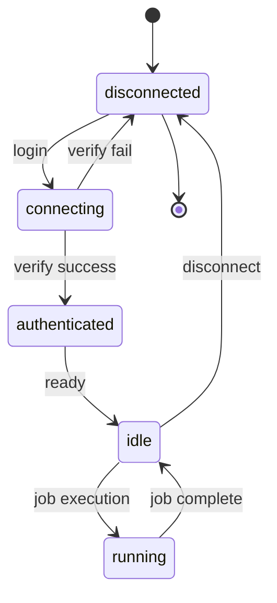

# Technical Specification: Provider Integration

## SPEC-ID: PROV-SPEC-001
## Version: 1.0
## Status: **HISTORICAL** (archived 2024-01-15)

> **Note**: This document is a historical draft from the project's early design phase. The current release-readiness plan is in `.plan/task.md` (updated November 2026). See the `.plan` directory for the active plan, release criteria, and M0-M5 milestones.

## Document: DRAFT
## Owner: @neuralforge/browser
## Related: JOB-SPEC-001, POLICY-SPEC-001

---

## A. Identity

- **Spec ID**: PROV-SPEC-001
- **Name**: Provider Integration
- **Version**: 1.0
- **Status**: DRAFT
- **Owner**: @neuralforge/browser
- **Related Requirements**: FR-001, FR-002, FR-009, FR-010
- **Dependencies**: @neuralforge/protocol, @neuralforge/platform, @neuralforge/tools, @neuralforge/policy

---

## B. Purpose

The Provider Integration layer enables NeuralForge to interact with web-based AI providers (ChatGPT, Gemini, Grok, DeepSeek, GLM, Kimi) through browser automation (Chrome DevTools Protocol) without requiring API keys. It provides:
- Session management per provider
- Authentication flow automation
- DOM interaction for message sending/receiving
- Profile isolation and persistence
- Status monitoring and health checks

---

## C. Scope

**Included**:
- Browser automation via Chrome DevTools Protocol (CDP)
- Provider-specific adapters (ChatGPT, Gemini, Grok, DeepSeek, GLM, Kimi)
- Session persistence with isolated Chrome profiles
- Authentication flow (login, verify, disconnect)
- Message sending and response streaming
- DOM-based identity verification
- Provider health and status monitoring
- Session timeout and cleanup

**Excluded**:
- API key management (not used)
- Direct API calls to providers (browser-only)
- Provider-specific model selection UI
- Rate limiting at provider level (handled by providers themselves)

---

## D. Functional Behavior

### Supported Providers

| Provider | ID | Authentication | Status |
|----------|-----|----------------|--------|
| ChatGPT | `chatgpt` | Browser session | ✅ Active |
| Gemini | `gemini` | Browser session | ✅ Active |
| Grok | `grok` | Browser session | ✅ Active |
| DeepSeek | `deepseek` | Browser session | ✅ Active |
| GLM | `glm` | Browser session | ✅ Active |
| Kimi | `kimi` | Browser session | ✅ Active |

### Browser Session Lifecycle



### Authentication Flow

1. **Login** (`/v1/providers/:id/login`):
   - Launch Chrome with isolated profile directory
   - Navigate to provider login URL
   - User completes authentication manually
   - Save profile to disk
   - Return `connecting` status

2. **Verify** (`/v1/providers/:id/verify`):
   - Launch Chrome with saved profile
   - Navigate to provider home
   - Probe DOM for authentication markers
   - Update status to `authenticated` or `disconnected`
   - Close browser

3. **Disconnect** (`DELETE /v1/providers/:id`):
   - Close any running browser
   - Delete profile directory
   - Remove from database

### Message Exchange Protocol

```
┌─────────────────────────────────────────────────────────────┐
│                    Message Flow                             │
├─────────────────────────────────────────────────────────────┤
│  Client → API Server → Job Service → Browser Adapter       │
│  ┌─────────────────────────────────────────────────────┐   │
│  │ 1. Create job with task                            │   │
│  │ 2. Assign to worker                                │   │
│  │ 3. Create browser adapter                         │   │
│  │ 4. Navigate to provider chat                      │   │
│  │ 5. Type message + Enter                           │   │
│  │ 6. Wait for response (streaming)                  │   │
│  │ 7. Parse response DOM                             │   │
│  │ 8. Extract text/code/images                       │   │
│  │ 9. Return to job service                          │   │
│  └─────────────────────────────────────────────────────┘   │
└─────────────────────────────────────────────────────────────┘
```

### DOM Probing Strategy

Each provider adapter implements `getAuthState()` by checking for specific DOM elements:

| Provider | Auth Indicator | Auth Selector |
|----------|----------------|---------------|
| ChatGPT | User menu / New chat button | `[data-testid="user-menu"]`, `button:has-text("New chat")` |
| Gemini | User avatar / New chat | `[data-user-avatar]`, `button:has-text("New chat")` |
| Grok | User profile / Send button | `[data-testid="user-profile"]`, `button:has-text("Send")` |
| DeepSeek | User menu / Chat list | `[data-testid="user-menu"]`, `div:has-text("New chat")` |
| GLM | User avatar / Chat input | `[data-user-avatar]`, `textarea[placeholder*="Message"]` |
| Kimi | User menu / New chat | `[data-testid="user-menu"]`, `button:has-text("New chat")` |

### Retry and Recovery

- **Transient failures**: Retry with exponential backoff (3 attempts)
- **Browser crash**: Restart browser, reuse profile
- **DOM changes**: Fallback selectors, version detection
- **Session expired**: Mark as disconnected, require re-auth

---

## E. Technical Design

### Architecture

```
┌──────────────────────────────────────────────────────┐
│                 Provider Integration Layer           │
├──────────────────────────────────────────────────────┤
│  HTTP API Layer         ┌──────────────────────────┐ │
│  /v1/providers          │   @neuralforge/browser         │ │
│  /v1/providers/:id      │   ┌────────────────────┐  │ │
│                         │   │ Adapter Registry   │  │ │
│  Job Service            │   │  (ChatGPT, Gemini) │  │ │
│  (createJob)            │   └─────────┬──────────┘  │ │
│                         │             │             │ │
│  Browser Pool           │   ┌─────────▼──────────┐  │ │
│  (CDP Connections)      │   │   Adapter Base     │  │ │
│                         │   │   (CDP Client)     │  │ │
│  Profile Storage        │   └─────────┬──────────┘  │ │
│  (isolated dirs)        │             │             │ │
│                         │   ┌─────────▼──────────┐  │ │
│                         │   │   Provider Drivers │  │ │
│                         │   │   (Gemini, ChatGPT│  │ │
│                         │   │   etc.)            │  │ │
│                         │   └─────────┬──────────┘  │ │
│                         │             │             │ │
│                         │   ┌─────────▼──────────┐  │ │
│                         │   │   CDP Client       │  │ │
│                         │   │   (playwright-core)│  │ │
│                         │   └────────────────────┘  │ │
│                         └──────────────────────────┘  │
└──────────────────────────────────────────────────────┘
```

### Module Structure

- `src/index.ts` — Main entry point, provider registry
- `src/adapters/` — Provider-specific implementations
- `src/browser-pool.ts` — Chrome instance management
- `src/profile-manager.ts` — Profile directory lifecycle
- `src/dom-probe.ts` — DOM element detection utilities
- `src/selector-manager.ts` — Selector fallback strategies
- `src/web-adapter.ts` — Base adapter interface

### Base Adapter Interface

```typescript
interface WebAdapter {
  launch(): Promise<void>;
  close(): Promise<void>;
  getAuthState(): Promise<'authenticated' | 'unauthenticated' | 'unknown'>;
  sendMessage(message: string): Promise<MessageResponse>;
  waitForResponse(timeout: number): Promise<MessageResponse>;
  isReady(): Promise<boolean>;
}
```

### Profile Management

| Location | Purpose | Retention |
|----------|---------|-----------|
| `.neuralforge/data/providers/{id}/` | Chrome user data dir | Until disconnect |
| `sessions/{id}/` | Session metadata | Until disconnect |
| `logs/` | Browser logs | Rotating, 7 days |

### CDP Session Management

- **Headless**: Enabled for CI, disabled for manual login
- **Profile isolation**: Separate profile per provider
- **Inactivity timeout**: 30 minutes
- **Memory limit**: 1GB per browser instance
- **Process isolation**: One Chrome per provider

---

## F. Data Contract

### Provider State Model

```typescript
interface ProviderState {
  providerId: string;
  configured: boolean;      // Profile directory exists
  authenticated: boolean;   // Login verified
  supported: boolean;       // Provider status active
  lastVerifiedAt: string;   // ISO 8601
  details?: {
    profileDir: string;
    browserPid?: number;
    lastActiveAt: string;
  };
}
```

### Provider Registry

```typescript
interface ProviderInfo {
  id: string;
  name: string;
  label: string;
  baseUrl: string;
  status: 'active' | 'deprecated' | 'maintenance';
  capabilities: ProviderCapability[];
  version: string;
}

interface ProviderCapability {
  id: string;
  name: string;
  supportsStreaming: boolean;
  supportsImageGen: boolean;
  supportsMusicGen: boolean;
  maxContextTokens: number;
  costPerToken: number;
}
```

### API Response Models

**GET /v1/providers**

```json
[
  {
    "id": "chatgpt",
    "name": "ChatGPT",
    "configured": true,
    "authenticated": true,
    "supported": true,
    "guidance": "Connect using a dedicated local browser profile.",
    "lastVerifiedAt": "2024-01-15T10:30:00Z"
  }
]
```

**POST /v1/providers/:id/login**

```json
{
  "id": "chatgpt",
  "status": "connecting"
}
```

**POST /v1/providers/:id/verify**

```json
{
  "id": "chatgpt",
  "authenticated": true
}
```

---

## G. API Contract

### Endpoint: GET /v1/providers

**Response**: 200 OK
```json
[
  {
    "id": "chatgpt",
    "name": "ChatGPT",
    "configured": true,
    "authenticated": true,
    "supported": true,
    "guidance": "Connect using a dedicated local browser profile.",
    "lastVerifiedAt": "2024-01-15T10:30:00Z"
  },
  {
    "id": "gemini",
    "name": "Gemini",
    "configured": false,
    "authenticated": false,
    "supported": true,
    "guidance": "Login required",
    "lastVerifiedAt": null
  }
]
```

### Endpoint: POST /v1/providers/:id/login

**Response**: 200 OK
```json
{
  "id": "chatgpt",
  "status": "connecting"
}
```

### Endpoint: POST /v1/providers/:id/verify

**Response**: 200 OK
```json
{
  "id": "chatgpt",
  "authenticated": true
}
```

### Endpoint: DELETE /v1/providers/:id

**Response**: 200 OK
```json
{
  "id": "chatgpt",
  "authenticated": false
}
```

### Error Responses

```json
{
  "error": {
    "code": "PROVIDER_UNAVAILABLE",
    "message": "Provider is unavailable.",
    "status": 404
  }
}
```

```json
{
  "error": {
    "code": "PROVIDER_NOT_CONNECTED",
    "message": "Provider 'chatgpt' must be connected before a job can run.",
    "status": 409
  }
}
```

---

## H. Security

### Trust Boundaries

- **Browser Instances**: Isolated per provider
- **Profile Directories**: Encrypted filesystem not required (user controls device)
- **Credentials**: None stored; session cookies only
- **CDP Connection**: Local only (127.0.0.1)

### Data Protection

- Profile directories stored in `.neuralforge/data/providers/`
- No plaintext credentials in database
- Session cookies validated before use
- Browser instances destroyed on disconnect

### Browser Isolation

- Each provider gets its own Chrome instance
- No cross-provider cookie sharing
- Profile directories not shared between providers
- Security flags: `--no-sandbox`, `--disable-setuid-sandbox` avoided

### Approval Integration

Browser automation requires approval for:
- New profile creation (first login)
- Profile cleanup (disconnect)
- Browser launch (login/verify)

---

## I. Reliability

### Failure Handling

| Failure Type | Recovery Strategy |
|--------------|-------------------|
| Browser crash | Restart instance, reuse profile |
| DOM changes | Fallback selectors, version detection |
| Network timeout | Retry with exponential backoff |
| Session expired | Mark disconnected, require re-auth |
| CDP disconnect | Reconnect, resume session |

### Timeouts

- **Login timeout**: 5 minutes (user manual step)
- **Verify timeout**: 30 seconds
- **Message send**: 10 seconds
- **Response wait**: 300 seconds (5 minutes)
- **Browser launch**: 15 seconds
- **Inactivity**: 30 minutes (auto-close)

### Retry Logic

- **Max attempts**: 3
- **Backoff**: 1s, 2s, 4s
- **Jitter**: ±20% to prevent thundering herd

---

## J. Performance

### Expected Workload

| Metric | Value |
|--------|-------|
| Concurrent browsers | 6 (one per provider) |
| Concurrent jobs | 100+ (queued) |
| Message send rate | 10/min per provider |
| Profile size | 50-200MB per provider |
| Browser memory | 300-500MB per instance |

### Performance Sensitive Paths

1. **DOM probing** → Selector optimization (target: <500ms)
2. **Message send** → Input + Enter (target: <2s)
3. **Response wait** → Streaming parse (target: <5s first token)
4. **Browser launch** → Profile + flags (target: <10s)

### Resource Constraints

- **Memory**: 1GB max total for all browsers
- **Disk**: 2GB max for all profiles
- **CPU**: 2 cores max for all browsers
- **Handles**: 1000 file descriptors max

### Caching Strategy

- Selector validation: Cached 24h
- Profile existence: Cached 5m
- Auth state: Cached 30s (real-time check on verify)

---

## K. UI/UX

### Provider Status Indicators

| State | Color | Label |
|-------|-------|-------|
| configured + authenticated | Green | Connected |
| configured + !authenticated | Yellow | Verification required |
| !configured | Red | Login required |
| !supported | Gray | Unsupported |

### User Interactions

- **Login**: Opens Chrome window, user completes auth
- **Verify**: Background check, no UI
- **Disconnect**: Immediate, no confirmation
- **Status**: Auto-refresh every 30s

### Error Handling

- **Login failed**: Show browser error page
- **Verify failed**: "Please reconnect"
- **Job execution failed**: Show provider error message

---

## L. Testing

### Unit Tests

| Module | Test Coverage |
|--------|---------------|
| Provider Registry | 100% registration/validation |
| Profile Manager | 100% directory lifecycle |
| DOM Probe | 100% selector detection |
| Adapter Base | 100% interface compliance |

### Integration Tests

- Login flow (manual intervention required in CI)
- Verify flow (automated with mock DOM)
- Message send/receive (automated with test pages)
- Session persistence across restarts
- Multi-provider isolation

### Browser Tests (test:media)

- Image download and validation
- Multi-image reply handling
- Interrupted recovery
- Music file handling
- Provider DOM behavior validation

---

## M. Acceptance Criteria

1. [ ] Provider list shows correct status for all 6 providers
2. [ ] Login flow opens browser and waits for user auth
3. [ ] Verify detects authentication state correctly
4. [ ] Disconnect removes profile and updates status
5. [ ] Job execution uses authenticated session
6. [ ] Session persistence survives application restart
7. [ ] Provider DOM changes detected with fallbacks
8. [ ] Browser instances isolated per provider
9. [ ] Timeouts enforce limits correctly
10. [ ] Error responses follow standard format

---

## N. Implementation Constraints

1. **Playwright**: 1.62.0 (core only, no test runner)
2. **Node.js**: ESM modules
3. **Chrome**: 120+ (CDP compatible)
4. **Profile isolation**: No shared state
5. **No API keys**: Browser session only
6. **Backward compatibility**: Existing API contract unchanged

---

## O. Revision History

| Version | Date | Author | Changes |
|---------|------|--------|---------|
| 1.0 | 2024-01-15 | Architecture | Initial draft |

---

## P. Related Specifications

- **JOB-SPEC-001**: Job Service Specification
- **TOOL-SPEC-001**: File System Tool Specification
- **POLICY-SPEC-001**: Approval Engine Specification
- **API-SPEC-001**: OpenAPI Specification (to be generated)