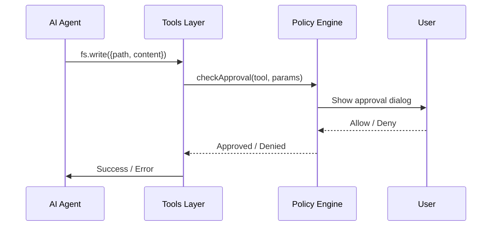

# Technical Specification: File System Tools

## SPEC-ID: TOOL-SPEC-001
## Version: 1.0
## Status: **HISTORICAL** (archived 2024-01-15)

> **Note**: This document is a historical draft from the project's early design phase. The current release-readiness plan is in `.plan/task.md` (updated November 2026). See the `.plan` directory for the active plan, release criteria, and M0-M5 milestones.

## Document: DRAFT
## Owner: @wtagent/tools
## Related: JOB-SPEC-001, POLICY-SPEC-001

---

## A. Identity

- **Spec ID**: TOOL-SPEC-001
- **Name**: File System Tools
- **Version**: 1.0
- **Status**: DRAFT
- **Owner**: @wtagent/tools
- **Related Requirements**: FR-001, FR-003, FR-004, FR-005, FR-011
- **Dependencies**: @wtagent/types, @wtagent/shared, @wtagent/policy, @wtagent/platform

---

## B. Purpose

The File System Tools package provides secure, sandboxed file system operations for AI agents. It enables:
- Reading, writing, and editing text files
- Searching file contents with ripgrep
- Terminal command execution
- All operations constrained by policy-driven sandbox modes
- Input validation and sanitization

---

## C. Scope

**Included**:
- `fs.read` — Read UTF-8 text files
- `fs.search` — Search file contents (ripgrep wrapper)
- `fs.write` — Create or replace files
- `fs.edit` — String replacement in existing files
- `terminal.exec` — Execute shell commands
- Sandbox mode enforcement (workspace-read, workspace-write, danger-full-access)
- Input validation and path normalization
- Policy engine integration for approval workflow

**Excluded**:
- Binary file operations (images, executables)
- Directory creation/deletion (use `fs.write` for files only)
- Network operations (use external packages)
- Database operations (handled by database package)
- Archive/zip operations (use `terminal.exec` with caution)

---

## D. Functional Behavior

### Sandbox Modes

| Mode | Permissions | Description |
|------|-------------|-------------|
| `workspace-read` | Read files under workspace | Code inspection, analysis |
| `workspace-write` | Read + write files under workspace | Code changes, file creation |
| `danger-full-access` | Full filesystem + terminal | Build commands, test execution |

### Tool Definitions

#### 1. `fs.read`

**Purpose**: Read UTF-8 text file content  
**Parameters**:
- `path`: string (absolute path)
- `offset`: number (optional, 1-based)
- `limit`: number (optional, default 2000)

**Returns**: 
- `content`: string (file content)
- `lines`: number[]
- `totalLines`: number

**Constraints**:
- Path must be within workspace (unless danger-full-access)
- Max file size: 10MB
- Encoding: UTF-8 only
- Binary files rejected

#### 2. `fs.search`

**Purpose**: Search file contents using ripgrep  
**Parameters**:
- `pattern`: string (regex pattern)
- `path`: string (directory to search, defaults to workspace)
- `include`: string (glob filter, e.g. "*.ts")
- `maxResults`: number (default 250)

**Returns**:
- `matches`: Array<{file: string, line: number, text: string}>
- `totalMatches`: number
- `filesSearched`: number

**Constraints**:
- Search limited to workspace boundary
- Max results: 250
- Timeout: 30 seconds
- Case insensitive by default

#### 3. `fs.write`

**Purpose**: Create or replace file content  
**Parameters**:
- `path`: string (absolute path)
- `content`: string (UTF-8 content)
- `append`: boolean (default false)

**Returns**: { `bytesWritten`: number }

**Constraints**:
- Path must be within workspace (unless danger-full-access)
- Max file size: 10MB
- Parent directories created automatically
- Overwrites existing content (unless append=true)

#### 4. `fs.edit`

**Purpose**: Edit existing file by string replacement  
**Parameters**:
- `path`: string (absolute path)
- `oldString`: string (exact match required)
- `newString`: string (replacement)
- `replaceAll`: boolean (default false)

**Returns**: { `replacedCount`: number }

**Constraints**:
- Path must be within workspace (unless danger-full-access)
- `oldString` must appear exactly once (unless replaceAll=true)
- Max file size: 10MB
- Preserves file encoding and line endings

#### 5. `terminal.exec`

**Purpose**: Execute shell command  
**Parameters**:
- `command`: string (shell command)
- `workdir`: string (optional, defaults to workspace)
- `timeoutMs`: number (optional, default 30000)
- `env`: Record<string, string> (optional)

**Returns**:
- `stdout`: string
- `stderr`: string
- `exitCode`: number
- `durationMs`: number

**Constraints**:
- Dangerous commands blocked by policy
- Timeout enforced
- Output capped at 10MB
- `danger-full-access` required

---

## E. Technical Design

### Architecture

```
┌──────────────────────────────────────────────────────┐
│                    Tools Layer                     │
├──────────────────────────────────────────────────────┤
│  Tool Registry          │  Policy Engine             │
│  (fs.read, fs.write,    │  ┌─────────────────────┐  │
│   fs.search, fs.edit,   │  │  Approval Check     │  │
│   terminal.exec)        │  └─────────┬───────────┘  │
│          │              │            │             │
│          ▼              │            ▼             │
│  ┌─────────────────┐    │  ┌─────────────────┐    │
│  │  Input Validator│    │  │  Path Guard     │    │
│  │  (Zod schemas)  │    │  │  (Path resolution)│   │
│  └─────────┬───────┘    │  └─────────┬───────────┘    │
│            │            │            │             │
│            ▼            │            ▼             │
│  ┌─────────────────┐    │  ┌─────────────────┐    │
│  │  Tool Executors │    │  │  Policy Decider │    │
│  │  (Node.js impl) │    │  │  (Allow/Deny)   │    │
│  └─────────────────┘    │  └─────────────────┘    │
└──────────────────────────────────────────────────────┘
```

### Module Structure

- `src/index.ts` — Tool registry and exports
- `src/fs/` — File system tool implementations
- `src/terminal-exec.ts` — Terminal command execution
- `src/safe-env.ts` — Environment sanitization
- `src/process-utils.ts` — Process spawning and management
- `src/search-fallback.ts` — Native search fallback
- `src/registry.ts` — Tool registration and discovery

### Path Resolution & Guarding

All file paths undergo validation:

```typescript
function resolvePath(path: string, projectRoot: string): string {
  const resolved = path.resolve(projectRoot, path);
  const root = path.resolve(projectRoot);
  
  if (!resolved.startsWith(root) && mode !== 'danger-full-access') {
    throw new Error(`Path outside workspace: ${path}`);
  }
  
  return resolved;
}
```

### Policy Engine Integration

Tool execution flow:

```
Tool Call → Input Validation → Path Guard → Policy Check → Approval Required? → User Decision → Execute/Reject
```

### Validation Schemas (Zod)

```typescript
// fs.read
const fsReadSchema = z.object({
  path: z.string().min(1),
  offset: z.number().int().min(1).optional(),
  limit: z.number().int().min(1).max(10000).optional()
});

// fs.search
const fsSearchSchema = z.object({
  pattern: z.string().min(1),
  path: z.string().optional(),
  include: z.string().optional(),
  maxResults: z.number().int().min(1).max(1000).optional()
});

// fs.write
const fsWriteSchema = z.object({
  path: z.string().min(1),
  content: z.string(),
  append: z.boolean().optional()
});

// fs.edit
const fsEditSchema = z.object({
  path: z.string().min(1),
  oldString: z.string().min(1),
  newString: z.string().optional(),
  replaceAll: z.boolean().optional()
});

// terminal.exec
const terminalExecSchema = z.object({
  command: z.string().min(1),
  workdir: z.string().optional(),
  timeoutMs: z.number().int().min(1000).max(300000).optional(),
  env: z.record(z.string()).optional()
});
```

---

## F. Data Contract

### Tool Response Format

All tools return a standard format:

```typescript
interface ToolResult<T = unknown> {
  success: boolean;
  data?: T;
  error?: {
    code: string;
    message: string;
  };
}
```

### Individual Tool Responses

**fs.read**
```json
{
  "success": true,
  "data": {
    "content": "file content...",
    "lines": [1, 2, 3, ...],
    "totalLines": 42
  }
}
```

**fs.search**
```json
{
  "success": true,
  "data": {
    "matches": [
      {"file": "src/index.ts", "line": 10, "text": "import ..."},
      {"file": "src/app.ts", "line": 5, "text": "export ..."}
    ],
    "totalMatches": 2,
    "filesSearched": 15
  }
}
```

**fs.write**
```json
{
  "success": true,
  "data": {
    "bytesWritten": 1234
  }
}
```

**fs.edit**
```json
{
  "success": true,
  "data": {
    "replacedCount": 3
  }
}
```

**terminal.exec**
```json
{
  "success": true,
  "data": {
    "stdout": "output...",
    "stderr": "",
    "exitCode": 0,
    "durationMs": 150
  }
}
```

### Error Responses

```json
{
  "success": false,
  "error": {
    "code": "VALIDATION_ERROR",
    "message": "Path must be within workspace"
  }
}
```

```json
{
  "success": false,
  "error": {
    "code": "APPROVAL_REQUIRED",
    "message": "Terminal execution requires approval"
  }
}
```

```json
{
  "success": false,
  "error": {
    "code": "FILE_NOT_FOUND",
    "message": "File not found: src/nonexistent.ts"
  }
}
```

---

## G. API Contract

### Tool Registry

```typescript
interface Tool {
  name: string;
  description: string;
  parameters: z.ZodObject<...>;
  execute: (params: unknown, context: ToolContext) => Promise<ToolResult>;
  sandbox: 'workspace-read' | 'workspace-write' | 'danger-full-access';
}

const toolRegistry = new Map<string, Tool>();
```

### Tool Context

```typescript
interface ToolContext {
  projectRoot: string;
  sandboxMode: 'workspace-read' | 'workspace-write' | 'danger-full-access';
  policyEngine: PolicyEngine;
  logger: Logger;
}
```

### Registration Example

```typescript
toolRegistry.set('fs.read', {
  name: 'fs.read',
  description: 'Read UTF-8 text file',
  parameters: fsReadSchema,
  execute: fsReadExecutor,
  sandbox: 'workspace-read'
});
```

---

## H. Security

### Path Guarding

1. **Path Resolution**: Resolve relative to projectRoot
2. **Boundary Check**: Ensure resolved path starts with projectRoot (unless danger-full-access)
3. **Symlink Resolution**: Follow symlinks, but guard against escapes
4. **Normalization**: Resolve `..` and `.` segments
5. **Windows Paths**: Handle drive letters and UNC paths

### Input Sanitization

- **Command Injection**: Terminal commands sanitized via argument array
- **Path Traversal**: `../` blocked in workspace modes
- **Null Bytes**: Rejected in file paths
- **Unicode**: Normalized to NFC

### Approval Flow



### Dangerous Command Blocking

Terminal commands blocked by policy:
- `rm -rf /`, `dd if=`, `mkfs`, `fdisk`
- `curl`, `wget` with remote execution
- `chmod 777`, `chown root`
- `nc`, `ncat`, `netcat` (network)
- `ssh`, `scp`, `rsync` (remote)
- `sudo`, `su`, `doas` (privilege escalation)

---

## I. Reliability

### Error Handling

| Error Type | Code | Recovery |
|------------|------|----------|
| Validation error | VALIDATION_ERROR | Fix input |
| Path outside workspace | PATH_OUTSIDE_WORKSPACE | Use relative path |
| File not found | FILE_NOT_FOUND | Check path |
| Permission denied | PERMISSION_DENIED | Check sandbox mode |
| Approval required | APPROVAL_REQUIRED | User action needed |
| Timeout | TIMEOUT | Retry with larger timeout |
| Max size exceeded | MAX_SIZE_EXCEEDED | Use streaming / chunking |

### Timeouts

- **File operations**: 10 seconds
- **Search operations**: 30 seconds
- **Terminal commands**: Configurable (default 30s)
- **Policy check**: 5 seconds

### Retry Logic

- **Transient errors**: Retry 3 times (exponential backoff)
- **Policy errors**: No retry (requires user action)
- **Validation errors**: No retry (input issue)

### Resource Limits

- **Max file size**: 10MB (read/write/edit)
- **Max search results**: 250
- **Max search files**: 1000
- **Max terminal output**: 10MB (stdout + stderr)
- **Max concurrent tools**: 10 per job

---

## J. Performance

### Expected Workload

| Metric | Value |
|--------|-------|
| Concurrent tools | 10 per job |
| File read/write | 100 ops/sec |
| Search operations | 10 ops/sec |
| Terminal commands | 5 ops/sec |

### Performance Sensitive Paths

1. **Path resolution** → Realpath cache (target: <1ms)
2. **File read** → Streaming for large files (target: <50ms for 1MB)
3. **Search** → ripgrep optimization (target: <1s for 100 files)
4. **Terminal** → Spawn optimization (target: <50ms spawn)

### Resource Constraints

- **Memory**: 50MB per tool instance max
- **Disk**: 1GB for temp files
- **File descriptors**: 1000 max
- **Processes**: 50 max concurrent

### Caching Strategy

- File stats: Cached 1s
- Directory listings: Cached 5s
- ripgrep binary: Pre-resolved
- Policy decisions: Cached 30s

---

## K. UI/UX

### Tool Usage Patterns

```javascript
// Simple read
const { content } = await tools.fs.read({ path: "src/index.ts" });

// Search with filter
const { matches } = await tools.fs.search({
  pattern: "TODO",
  include: "*.ts",
  maxResults: 50
});

// Write file
await tools.fs.write({ path: "src/new.ts", content: "export const x = 1;" });

// Edit file
await tools.fs.edit({
  path: "src/index.ts",
  oldString: "const x = 1;",
  newString: "const x = 2;",
  replaceAll: false
});

// Terminal command
const { stdout, exitCode } = await tools.terminal.exec({
  command: "npm test",
  timeoutMs: 60000
});
```

### Error Presentation

- **Validation errors**: Inline with field highlighting
- **Approval required**: Modal dialog with tool details
- **Execution errors**: Toast notification with details
- **Timeouts**: Retry option with extended timeout

### Accessibility

- Screen reader friendly error messages
- Keyboard navigation for approval dialogs
- High contrast mode support

---

## L. Testing

### Unit Tests

| Module | Test Coverage |
|--------|---------------|
| FS Read/Write/Edit/Search | 100% edge cases |
| Terminal Exec | 100% command variants |
| Path Guarding | 100% boundary tests |
| Policy Integration | 100% approval flows |
| Input Validation | 100% Zod schemas |

### Integration Tests

- Cross-tool workflows (read → edit → write)
- Large file handling (10MB+)
- Concurrent tool execution
- Policy approval/denial scenarios
- Dangerous command blocking
- Path traversal prevention

### Performance Tests

- 10MB file read/write latency
- Search 1000 files with regex
- 100 concurrent tool calls
- Terminal command throughput

---

## M. Acceptance Criteria

1. [ ] All 5 tools registered and accessible
2. [ ] `fs.read` handles UTF-8, large files, offsets/limits
3. [ ] `fs.search` uses ripgrep, respects include/maxResults
4. [ ] `fs.write` creates files, appends, handles 10MB limit
5. [ ] `fs.edit` replaces exact matches, handles replaceAll
6. [ ] `terminal.exec` executes commands, captures output
7. [ ] Sandbox modes enforce path boundaries correctly
8. [ ] Policy engine triggers approval when required
9. [ ] Dangerous commands blocked (rm, curl, etc.)
10. [ ] Error responses follow standard format
11. [ ] Timeouts enforce limits
12. [ ] Input validation rejects malformed parameters

---

## N. Implementation Constraints

1. **Node.js**: ESM modules, TypeScript 5.9
2. **Ripgrep**: Required binary (bundled or system)
3. **Zod**: Runtime validation
4. **No external dependencies**: Only workspace packages
5. **Backward compatibility**: Existing tool contract unchanged
6. **Security**: No command injection, no path traversal

---

## O. Revision History

| Version | Date | Author | Changes |
|---------|------|--------|---------|
| 1.0 | 2024-01-15 | Architecture | Initial draft |

---

## P. Related Specifications

- **JOB-SPEC-001**: Job Service Specification
- **PROV-SPEC-001**: Provider Integration Specification
- **POLICY-SPEC-001**: Approval Engine Specification
- **API-SPEC-001**: OpenAPI Specification (to be generated)