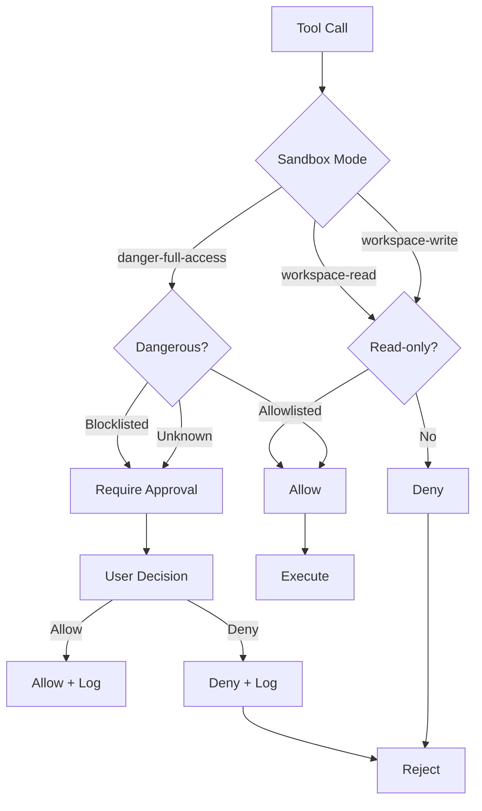

# Technical Specification: Policy Engine

## SPEC-ID: POLICY-SPEC-001
## Version: 1.0
## Status: **HISTORICAL** (archived 2024-01-15)

> **Note**: This document is a historical draft from the project's early design phase. The current release-readiness plan is in `.plan/task.md` (updated November 2026). See the `.plan` directory for the active plan, release criteria, and M0-M5 milestones.

## Document: DRAFT
## Owner: @wtagent/policy
## Related: JOB-SPEC-001, TOOL-SPEC-001, PROV-SPEC-001

---

## A. Identity

- **Spec ID**: POLICY-SPEC-001
- **Name**: Policy Engine
- **Version**: 1.0
- **Status**: DRAFT
- **Owner**: @wtagent/policy
- **Related Requirements**: FR-005, FR-006, FR-007, FR-008, FR-012
- **Dependencies**: @wtagent/types, @wtagent/shared, @wtagent/platform

---

## B. Purpose

The Policy Engine enforces security boundaries and approval workflows for all tool operations. It provides:
- Sandbox mode enforcement (workspace-read, workspace-write, danger-full-access)
- Approval workflow for dangerous operations
- Path traversal prevention
- Command injection prevention
- Audit logging for all operations
- Configurable policy rules

---

## C. Scope

**Included**:
- Sandbox mode validation for all file/terminal operations
- Approval workflow (prompt user, record decision)
- Path boundary enforcement
- Command allowlisting/blocklisting
- Audit logging (JSONL format)
- Policy rule configuration (JSON/YAML)
- Runtime policy evaluation
- Context-aware decisions (tool + parameters)

**Excluded**:
- Role-based access control (RBAC) — single user model
- Network firewall rules — OS level
- Encryption at rest — filesystem level
- Multi-user isolation — single user per instance
- External policy servers — local only

---

## D. Functional Behavior

### Sandbox Modes

| Mode | File Operations | Terminal Operations | Approval Required |
|------|----------------|---------------------|-------------------|
| `workspace-read` | Read only (within workspace) | None | No |
| `workspace-write` | Read + write (within workspace) | None | No |
| `danger-full-access` | Full filesystem | Full terminal | Yes (selective) |

### Approval Rules

| Tool | Parameters | Approval Required? | Reason |
|------|------------|-------------------|--------|
| `fs.read` | Any | No | Read-only within sandbox |
| `fs.search` | Any | No | Read-only within sandbox |
| `fs.write` | New file | No | Create within sandbox |
| `fs.write` | Existing file | Yes | Overwrite risk |
| `fs.edit` | Any | Yes | Mutation risk |
| `terminal.exec` | Allowlisted commands | No | Safe commands |
| `terminal.exec` | Blocklisted commands | Yes | Dangerous commands |
| `terminal.exec` | New commands | Yes | Unknown command |
| `browser.connect` | New provider | Yes | New profile creation |
| `browser.disconnect` | Any | Yes | Profile deletion |

### Decision Matrix



### Policy Rule Format

```yaml
# policies/default.yaml
rules:
  - id: fs-read-allow
    tool: fs.read
    action: allow
    condition: true
    
  - id: fs-write-create
    tool: fs.write
    action: allow
    condition: "pathDoesNotExist"
    
  - id: fs-write-overwrite
    tool: fs.write
    action: require_approval
    condition: "pathExists"
    
  - id: fs-edit-require
    tool: fs.edit
    action: require_approval
    condition: true
    
  - id: terminal-safe
    tool: terminal.exec
    action: allow
    condition: "commandInAllowlist"
    
  - id: terminal-dangerous
    tool: terminal.exec
    action: require_approval
    condition: "commandInBlocklist"
    
  - id: terminal-unknown
    tool: terminal.exec
    action: require_approval
    condition: "commandNotInLists"
```

### Approval Storage

```typescript
interface ApprovalRecord {
  id: string;                  // UUID
  tool: string;                // Tool name
  parameters: Record<string, unknown>;
  decision: 'allow' | 'deny';
  decidedAt: string;           // ISO 8601
  decidedBy: string;           // User ID (always "user" in local mode)
  reason?: string;             // Optional reason
  context: {
    projectRoot: string;
    sandboxMode: string;
    timestamp: string;
  };
}
```

---

## E. Technical Design

### Architecture

```
┌──────────────────────────────────────────────────────┐
│                    Policy Engine                   │
├──────────────────────────────────────────────────────┤
│  Policy Evaluator        │  Approval Manager          │
│  (Rule matching)         │  (User interaction)        │
│  ┌─────────────────────┐  │  ┌──────────────────┐  │
│  │  Rule Engine        │  │  │  Approval Store  │  │
│  │  (YAML/JSON parser) │  │  │  (JSONL file)    │  │
│  └─────────┬───────────┘  │  └─────────┬──────────┘  │
│            │              │            │             │
│            ▼              │            ▼             │
│  ┌─────────────────┐    │  ┌─────────────────┐    │
│  │  Context Builder│    │  │  Audit Logger   │    │
│  │  (tool + params)│    │  │  (JSONL writer) │    │
│  └─────────────────┘    │  └─────────────────┘    │
│            │              │            │             │
│            ▼              │            ▼             │
│  ┌─────────────────┐    │  ┌─────────────────┐    │
│  │  Decision Cache │    │  │  Notification   │    │
│  │  (TTL 30s)      │    │  │  (WebSocket/SSE)│    │
│  └─────────────────┘    │  └─────────────────┘    │
└──────────────────────────────────────────────────────┘
```

### Module Structure

- `src/index.ts` — Main entry point, PolicyEngine class
- `src/policy-engine.ts` — Rule evaluation and decision logic
- `src/approval-manager.ts` — User interaction and storage
- `src/audit-logger.ts` — JSONL audit logging
- `src/rule-parser.ts` — YAML/JSON rule parsing
- `src/path-guard.ts` — Path boundary validation
- `src/command-guard.ts` — Command allow/block listing
- `src/types.ts` — TypeScript interfaces

### Policy Evaluation Algorithm

```typescript
function evaluatePolicy(
  tool: string,
  params: Record<string, unknown>,
  context: PolicyContext
): PolicyDecision {
  // 1. Build evaluation context
  const evalContext = buildContext(tool, params, context);
  
  // 2. Check cache (TTL 30s)
  const cached = cache.get(evalContext.key);
  if (cached) return cached;
  
  // 3. Match rules in order
  for (const rule of rules) {
    if (rule.matches(evalContext)) {
      const decision = rule.decide(evalContext);
      
      // 4. Cache decision
      cache.set(evalContext.key, decision, 30000);
      
      // 5. Log audit
      auditLogger.log(evalContext, decision);
      
      return decision;
    }
  }
  
  // 6. Default deny
  return denyDecision('No matching rule');
}
```

### Path Guarding

```typescript
function validatePath(
  path: string,
  projectRoot: string,
  mode: SandboxMode
): string {
  const resolved = path.resolve(projectRoot, path);
  const root = path.resolve(projectRoot);
  
  if (mode === 'danger-full-access') return resolved;
  
  if (!resolved.startsWith(root)) {
    throw new Error(`Path outside workspace: ${path}`);
  }
  
  // Resolve symlinks and check again
  const real = path.realpathSync(resolved);
  if (!real.startsWith(root)) {
    throw new Error(`Symlink escape: ${path}`);
  }
  
  return real;
}
```

### Command Guarding

```typescript
function validateCommand(
  command: string,
  allowlist: string[],
  blocklist: string[]
): CommandDecision {
  const normalized = command.trim().split(/\s+/)[0];
  
  if (blocklist.includes(normalized)) return { allow: false, reason: 'blocklisted' };
  if (allowlist.includes(normalized)) return { allow: true, reason: 'allowlisted' };
  
  return { allow: false, reason: 'unknown-command' };
}
```

### Audit Logging

```jsonl
{"timestamp":"2024-01-15T10:30:00Z","tool":"fs.write","path":"/project/src/index.ts","action":"create","decision":"allow","user":"user"}
{"timestamp":"2024-01-15T10:30:01Z","tool":"terminal.exec","command":"npm test","decision":"allow","user":"user"}
{"timestamp":"2024-01-15T10:30:02Z","tool":"fs.edit","path":"/project/src/index.ts","action":"modify","decision":"require_approval","user":"user"}
{"timestamp":"2024-01-15T10:30:05Z","tool":"fs.edit","path":"/project/src/index.ts","action":"modify","decision":"allow","user":"user"}
```

---

## F. Data Contract

### Policy Context

```typescript
interface PolicyContext {
  projectRoot: string;
  sandboxMode: SandboxMode;
  userId: string;
  timestamp: string;
  metadata?: Record<string, unknown>;
}

type SandboxMode = 'workspace-read' | 'workspace-write' | 'danger-full-access';
```

### Policy Decision

```typescript
interface PolicyDecision {
  action: 'allow' | 'deny' | 'require_approval';
  reason: string;
  metadata?: Record<string, unknown>;
}
```

### Approval Record

```typescript
interface ApprovalRecord {
  id: string;
  tool: string;
  parameters: Record<string, unknown>;
  decision: 'allow' | 'deny';
  decidedAt: string;
  decidedBy: string;
  reason?: string;
  context: {
    projectRoot: string;
    sandboxMode: SandboxMode;
    timestamp: string;
  };
}
```

### Audit Log Entry

```typescript
interface AuditLogEntry {
  timestamp: string;
  tool: string;
  parameters: Record<string, unknown>;
  decision: 'allow' | 'deny' | 'require_approval';
  user: string;
  context: PolicyContext;
}
```

### Policy Rules

```typescript
interface PolicyRule {
  id: string;
  tool: string;
  condition: string | ((context: EvalContext) => boolean);
  action: 'allow' | 'deny' | 'require_approval';
  reason: string;
  priority?: number; // Higher first
}
```

---

## G. API Contract

### Policy Engine Interface

```typescript
interface PolicyEngine {
  evaluate(tool: string, params: unknown, context: PolicyContext): Promise<PolicyDecision>;
  requestApproval(tool: string, params: unknown, context: PolicyContext): Promise<ApprovalRecord>;
  logAudit(entry: AuditLogEntry): void;
  loadRules(rules: PolicyRule[]): void;
  getRules(): PolicyRule[];
  clearCache(): void;
}
```

### Approval Manager Interface

```typescript
interface ApprovalManager {
  request(tool: string, params: unknown, context: PolicyContext): Promise<ApprovalRecord>;
  decide(approvalId: string, decision: 'allow' | 'deny', reason?: string): void;
  getPending(): ApprovalRecord[];
  getHistory(): ApprovalRecord[];
}
```

### Audit Logger Interface

```typescript
interface AuditLogger {
  log(entry: AuditLogEntry): void;
  read(range: { from: string; to: string }): AuditLogEntry[];
  rotate(): void;
}
```

### HTTP API Endpoints (if exposed)

**POST /v1/policy/evaluate**

```json
{
  "tool": "fs.write",
  "params": { "path": "src/index.ts", "content": "..." },
  "context": {
    "projectRoot": "/home/user/project",
    "sandboxMode": "workspace-write"
  }
}
```

**Response**: 200 OK
```json
{
  "action": "require_approval",
  "reason": "File overwrite requires approval"
}
```

**POST /v1/policy/approve**

```json
{
  "approvalId": "uuid",
  "decision": "allow",
  "reason": "User approved file overwrite"
}
```

**Response**: 200 OK
```json
{
  "approvalId": "uuid",
  "decision": "allow",
  "recordedAt": "2024-01-15T10:30:00Z"
}
```

---

## H. Security

### Threat Model

| Threat | Mitigation |
|--------|------------|
| Path traversal | Path Guard + realpath validation |
| Command injection | Argument array + shell quoting |
| Privilege escalation | No sudo/su/doas in terminal |
| Data exfiltration | Network disabled in danger mode (future) |
| Infinite loops | Timeout enforcement |
| Approval bypass | Context-aware evaluation |

### Data Protection

- Approval records stored in `.wtagent/data/approvals/`
- Audit logs stored in `.wtagent/data/audit/`
- No plaintext credentials in logs
- File permissions: 0600 (owner only)

### Access Control

- Single user model: "user"
- No authentication required (local-first)
- Policy engine runs in same process as tools
- No network exposure by default

### Approval Security

- Approval IDs are UUID v4
- No replay attacks (single-use decisions)
- Decision binding to context (tool + params + timestamp)
- User confirmation required for each distinct operation

---

## I. Reliability

### Failure Handling

| Failure Type | Recovery Strategy |
|--------------|-------------------|
| Policy file corrupt | Fallback to hardcoded defaults |
| Audit log corrupt | Rotate and start new |
| Approval DB corrupt | Recreate from audit logs |
| Cache corruption | Clear cache, re-evaluate |
| Rule syntax error | Skip rule, log warning |

### Timeouts

- **Policy evaluation**: 100ms
- **Approval request**: 5 minutes (user timeout)
- **Audit write**: 50ms
- **Cache TTL**: 30 seconds

### Retry Logic

- **Audit write**: Retry 3 times (exponential backoff)
- **Approval storage**: Retry 3 times
- **Policy load**: Retry once on startup

### Resource Limits

- **Rules**: 100 max
- **Cache entries**: 1000 max
- **Audit log size**: 1GB (rotating)
- **Approval records**: 10000 max (rotating)

---

## J. Performance

### Expected Workload

| Metric | Value |
|--------|-------|
| Policy evaluations | 100/sec |
| Approval requests | 10/min |
| Audit writes | 100/sec |
| Rule reloads | 1/min |

### Performance Sensitive Paths

1. **Rule matching** → Compiled regex + early exit (target: <10ms)
2. **Path validation** → Realpath cache (target: <1ms)
3. **Command validation** → Hash set lookup (target: <1ms)
4. **Audit write** → Buffered JSONL (target: <10ms)

### Resource Constraints

- **Memory**: 10MB max for policy engine
- **Disk**: 500MB max for policies/audit
- **CPU**: Negligible (mostly I/O bound)
- **Handles**: 100 file descriptors max

### Caching Strategy

- **Rule cache**: TTL 30s, LRU eviction
- **Path cache**: TTL 5s, realpath resolution
- **Command cache**: TTL 1h, allow/block lookup
- **Approval cache**: None (fresh each time)

---

## K. UI/UX

### Approval Dialog

```text
┌─────────────────────────────────────────────────────────────┐
│                    APPROVAL REQUIRED                        │
├─────────────────────────────────────────────────────────────┤
│ Tool: fs.edit                                               │
│ Path: /project/src/index.ts                                 │
│ Action: Overwrite existing file                             │
│ Risk: Data loss possible                                    │
│                                                             │
│ Parameters:                                                 │
│   oldString: "const x = 1;"                                 │
│   newString: "const x = 2;"                                 │
│   replaceAll: false                                         │
│                                                             │
│ [ Allow ]    [ Deny ]    [ Remember for this session ]      │
└─────────────────────────────────────────────────────────────┘
```

### User Interactions

- **Approval prompt**: Modal dialog with tool details
- **Risk explanation**: Clear description of what will happen
- **Remember option**: Session-wide remember (cleared on restart)
- **Cancel**: Deny and return error to agent
- **History**: View past approvals in Settings

### Error Handling

- **Policy error**: "Policy evaluation failed: [error]"
- **Approval timeout**: "Approval request timed out"
- **Invalid decision**: "Invalid approval decision"
- **Context mismatch**: "Context changed since approval request"

### Accessibility

- ARIA labels on all dialog elements
- Keyboard navigation (Tab, Enter, Escape)
- Screen reader announcements
- High contrast mode support

---

## L. Testing

### Unit Tests

| Module | Test Coverage |
|--------|---------------|
| Policy Evaluator | 100% rule matching |
| Approval Manager | 100% storage/retrieval |
| Path Guard | 100% boundary cases |
| Command Guard | 100% allow/block lists |
| Audit Logger | 100% JSONL format |
| Rule Parser | 100% YAML/JSON parsing |

### Integration Tests

- Full approval flow (request → decide → execute)
- Sandbox mode enforcement
- Command allowlisting/blocklisting
- Audit log rotation
- Policy reload at runtime
- Concurrent evaluations
- Approval timeout handling

### Performance Tests

- 1000 policy evaluations/sec
- 100 concurrent approval requests
- Audit log throughput (1MB/sec)
- Policy reload latency (<100ms)

---

## M. Acceptance Criteria

1. [ ] Policy engine evaluates rules correctly
2. [ ] Sandbox modes enforce path boundaries
3. [ ] Approval workflow works for dangerous operations
4. [ ] Command allowlisting blocks dangerous commands
5. [ ] Audit logs record all tool operations
6. [ ] Policy rules configurable via YAML/JSON
7. [ ] Approval decisions persist across restarts
8. [ ] Context-aware caching works correctly
9. [ ] Error responses follow standard format
10. [ ] Timeouts enforce limits
11. [ ] Resource limits prevent exhaustion
12. [ ] Unit tests cover 90%+ of logic

---

## N. Implementation Constraints

1. **Node.js**: ESM modules, TypeScript 5.9
2. **YAML**: js-yaml for rule parsing
3. **JSONL**: Line-delimited JSON for audit logs
4. **No external dependencies**: Only workspace packages
5. **Backward compatibility**: Existing policy contract unchanged
6. **Security**: No command injection, no path traversal

---

## O. Revision History

| Version | Date | Author | Changes |
|---------|------|--------|---------|
| 1.0 | 2024-01-15 | Architecture | Initial draft |

---

## P. Related Specifications

- **JOB-SPEC-001**: Job Service Specification
- **PROV-SPEC-001**: Provider Integration Specification
- **TOOL-SPEC-001**: File System Tool Specification
- **API-SPEC-001**: OpenAPI Specification (to be generated)